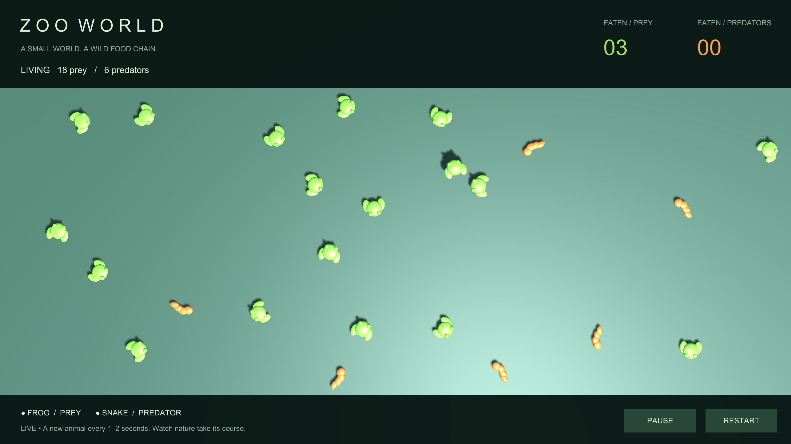

# Zoo World

A small 3D Unity ecosystem built for the Sakura Games Unity developer task. Frogs hop, snakes crawl, and physical contacts drive a simple food chain.

## Run

- Unity **6000.2.14f1**, built-in render pipeline.
- Add this folder through Unity Hub, open `Assets/ZooWorld/Scenes/ZooWorld.unity`, and press **Play**.
- The scene starts empty. One randomly selected animal appears every **1–2 seconds** (75% frogs, 25% snakes).
- **Pause / Resume** freezes and resumes the simulation; **Restart** clears the population, labels, and counters.
- No paid assets, ECS, or third-party packages. uGUI is the only non-module package.

## Behavior

| Animal | Diet | Movement | Contact result |
| --- | --- | --- | --- |
| Frog | Prey | A 1.8-unit hop every 1.4 seconds; 0.38-second flight | Bounces against prey, dies to a predator |
| Snake | Predator | Linear movement at 2.2 units/second | Eats prey; the older predator survives a predator duel |

All movement headings change at random intervals. Viewport-derived ground bounds steer animals back into the visible habitat, including after window resizing. The header/footer are excluded from those bounds. The top-right uGUI counters track eaten prey and predators separately. A short-lived **Tasty!** label follows the winner below its screen position.

A configurable habitat capacity (300 by default) prevents unattended sessions from allocating animals forever. At capacity, spawning pauses and the footer explains why; it resumes when an animal is eaten. This is a deliberate safeguard beyond the brief.

## Architecture

`ZooSimulation` is the composition root. It constructs and injects the arena and factory, creates the HUD, schedules births, and resolves food-chain contacts. There are no global service locators or singleton services.

- **AnimalDefinition**: ScriptableObject species data. Diet, mass, radius, spawn weight, appearance, and movement configuration are independent fields.
- **MovementProfile → IAnimalMotor**: strategy + factory. A shared immutable profile creates a separate stateful motor for every animal. Linear and jump movement never share timers. Adding movement does not require editing the actor or food chain.
- **AnimalActor**: a dynamic Rigidbody bridge. It receives dependencies explicitly, applies motor propulsion in FixedUpdate, changes heading at the viewport boundary, and forwards physical contacts.
- **FoodChain**: a small pure policy. Stable birth IDs resolve predator duels independently of which callback runs first. Prey never eat.
- **Population**: observable counters; the HUD subscribes to changes instead of polling counters every frame.
- **AnimalFactory / ZooHud**: presentation. Primitive meshes are generated without asset-store dependencies; materials are shared. Labels use uGUI and follow world positions.

DI is explicit constructor/initializer injection rather than a container dependency: the graph is small enough to inspect in one file. This demonstrates dependency separation without requiring reviewers to install a framework.

Death disables the collider and object immediately, updates population once, and schedules destruction. The second collision callback sees a dead participant and cannot double-count or kill the surviving predator. Collision resolution and UI updates run on Unity's main thread.

## Add another species

1. Create a species through **Assets → Create → Zoo World → Animal species**.
2. Assign a diet and an existing movement profile (or create a new profile asset).
3. Set appearance, radius, mass, and spawn weight. For a new silhouette, assign a **Visual Prefab** with meshes only; the actor supplies the physics body/collider.
4. Add the species asset to the scene's `ZooSimulation.Species` list.

A new movement pattern derives from `MovementProfile` and returns an `IAnimalMotor`. Profiles hold configuration; motors own per-animal state. No subclass per animal species, diet switch per species, or central list of 1,000 animal types is needed. The supplied primitive shape selector is only a fallback presentation for the two demo animals.

## Verification

Select **Zoo World → Run verification**. The checker enters Play Mode and writes `Verification.json` after success. It covers food-chain decisions, independent movement state, fixed jump distance, population bookkeeping, actual prey/prey and predator contacts, one death per duel, uGUI creation, button raycasts/click handlers, pause/restart, offscreen return, and timed spawning. Successful execution reports **19 checks** in the console. The report describes the editor version actually used.

Select **Zoo World → Create demo scene** only if the scene is missing. The first import also creates it automatically if necessary.

For a local Mac development build, use `ZooWorld.Editor.ProjectBuilder.Build` from batch mode or create a local `build.request` file in the project root while the editor is open. The output is `Builds/ZooWorld.app`. Optional `verify.request` and `preview.request` files trigger the verification and preview tools. These files are ignored by Git and never included in a player.

## Scope and tradeoffs

- Physics is planar (XZ), with Y and rotation constrained. Frog elevation is a visual arc; the ground contact footprint remains stable so a predator can collide with a hopping frog. Configured hop distance is measured without collisions; collisions may alter physical displacement.
- A sphere collider approximates each animal; graphics are primitive samples as allowed by the brief.
- Predator duels favor the older birth ID for deterministic, callback-order-independent results. No starvation or chasing is added.
- This supports many species definitions, not a claim of 1,000 simultaneous complex animals. GameObjects and physics remain intentionally conventional; no ECS, pooling framework, or unnecessary abstraction layer.
- Verification uses a self-contained editor runner rather than an external testing package. It includes real Play Mode contacts; manual visual inspection complements the automated checks.
